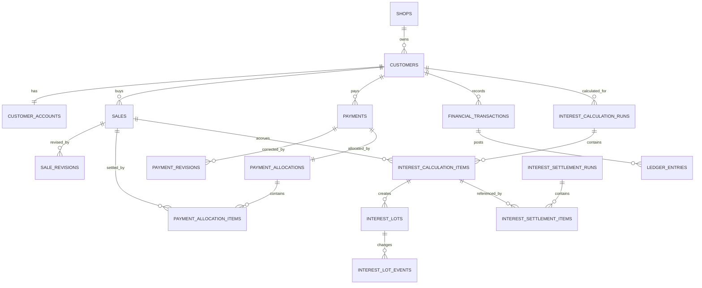

# Kisan Khata — Phase 5 Physical Database Schema

**Version:** 1.0  
**Date:** 2026-11-25  
**Status:** Proposed physical schema for Product Owner review  
**Controlling decision:** [ADR-0012 — Approved Financial Rules](decisions/ADR-0012-approved-financial-rules.md)  
**Logical blueprint:** [Phase 5 Implementation Blueprint](phase-5-implementation-blueprint.md)  
**Database target:** MySQL 8.4 / InnoDB  
**Application target:** Laravel 13

> This document is a schema design proposal, not a migration specification ready for blind execution. It does not authorize application code, migrations, data backfills, or database changes. Existing-code audit findings and the actual deployed schema must be rechecked immediately before implementation.

## 1. Purpose and authority

This document translates the approved Phase 5 financial rules into a tenant-safe physical relational model. ADR-0012 controls business behavior. This document controls the proposed table/column/constraint mapping only after Product Owner review.

The design covers the Customer financial subledger, Sales, consolidated Payments with internal FIFO allocations, effective-dated financial policy, interest calculation and lots, annual Interest Auto Settlement, reversals, idempotency, audit integration, and rebuildable balance projections.

Crop-season settlement accounting is outside this schema scope. Annual Interest Auto Settlement is an interest-calculation event, not a crop-season account closure.

### 1.1 Superseded legacy proposals

ADR-0012 supersedes older architecture statements that:
- prohibit internal Sale-wise payment allocations;
- say that Payments cannot be allocated to Sales or split into Principal/Interest components;
- require customer advances for excess payments;
- imply direct overwriting of posted Sales or Payments.

Accordingly:
- `payment_allocations` and `payment_allocation_items` are required;
- normal customer-facing Payments remain consolidated;
- excess Payment is rejected; no advance table/workflow is proposed;
- posted Payment correction is reversal and optional replacement;
- a locked historical Sale has no approved exception path.

The older sections in `docs/02-business-rules.md` and `docs/04-database-architecture.md` must be read subject to ADR-0012 and this approved Phase 5 addendum. This document does not silently rewrite those documents.

## 2. Physical design conventions

| Concern | Proposed standard |
|---|---|
| Storage engine | InnoDB |
| Character set | utf8mb4 |
| Primary keys | BIGINT UNSIGNED auto-increment, matching existing Laravel `$table->id()` |
| Tenant key | BIGINT UNSIGNED `shop_id` on every tenant-owned financial row |
| Customer/Sale/Payment IDs | BIGINT UNSIGNED |
| INR posted amounts | DECIMAL(15,2), non-negative at row level |
| Intermediate financial basis | DECIMAL(20,8) minimum |
| Monthly percentage rate | DECIMAL(12,8), expressed as percentage (e.g. 2.50000000 means 2.5%) |
| Effective/business dates | DATE |
| Event/record timestamps | DATETIME(6), UTC by application convention |
| JSON | Only for immutable before/after snapshots or non-query-critical metadata |
| Status/type values | VARCHAR plus CHECK constraints where supported; avoid relying on MySQL ENUM migrations |
| Deletion | No cascade deletion from shops/customers into posted financial history |

All authoritative money calculations must use decimal-safe PHP arithmetic and MySQL DECIMAL. PHP binary floating-point values must never be used for authoritative balances, interest, or allocation.

Store business dates as DATE. Store actual event instants in DATETIME(6) UTC. The Shop timezone is used to interpret user-entered local event times and configured annual event dates; persist the resolved UTC event timestamp and business date separately where both are needed.

### 2.1 Monetary sign convention

- A debit increases Customer receivable.
- A credit decreases Customer receivable.
- Sale posting debits Principal.
- Interest posting debits Interest or Principal, depending on the effective capitalization classification.
- Payment posting credits the component it settles.
- Capitalization is a reclassification: debit Principal and credit Interest for the same amount; it must not increase total receivable.
- Reversal posts equal and opposite compensating entries; original ledger rows remain unchanged.

This is a Customer subledger, not a company-wide statutory double-entry General Ledger. A future general ledger would require a separate chart-of-accounts and balancing design.

## 3. Existing tables reused

The read-only audit found existing `shops`, `shop_settings`, `customers`, `users`, and append-only `audit_logs` foundations. Do not recreate them.

Relevant current schema facts to preserve:
- `shops.id`, `customers.id`, `users.id` are Laravel BIGINT UNSIGNED IDs.
- `customers.shop_id` is a foreign key to `shops.id`; `customers.created_by` references `users.id`.
- `users.shop_id` is nullable at the schema level for platform-level accounts; financial actor references must additionally validate that the actor is an active member of the same Shop.
- `shop_settings` is a key/value table with unique `(shop_id, setting_key)`; it is not sufficient as the historical source of effective-dated financial policy.
- `audit_logs` is an append-only event foundation with nullable Shop and User references, entity type/id, reason, old/new JSON and created timestamp.

Before migrations, re-fetch the exact current migrations and model relationships. The audit's existing-schema findings are not a substitute for verifying the target branch immediately before implementation.

### 3.1 Required supporting unique keys

For composite tenant-safe foreign keys, add supporting unique keys in the relevant parent tables if they do not already exist:
- `shops`: UNIQUE `(id)` is already the primary key; child financial rows can reference `shop_id` directly.
- `customers`: UNIQUE `(shop_id, id)`.
- `users`: UNIQUE `(shop_id, id)` for shop-user actor references; platform users with NULL shop_id are not valid financial actors.
- `sales`: UNIQUE `(shop_id, id)` and UNIQUE `(shop_id, customer_id, id)` where required by downstream composite references.
- `payments`: UNIQUE `(shop_id, id)` and UNIQUE `(shop_id, customer_id, id)`.
- `financial_transactions`: UNIQUE `(shop_id, id)`.

MySQL requires referenced composite columns to have a matching unique index. Exact index names and whether some parent keys can be simplified must be verified in migration review.

## 4. Proposed table inventory

### Core customer accounting
1. `customer_accounts`
2. `sales`
3. `sale_revisions`
4. `payments`
5. `payment_revisions`
6. `payment_allocations`
7. `payment_allocation_items`
8. `financial_transactions`
9. `ledger_entries`
10. `account_balance_snapshots`

### Effective-dated policy
11. `interest_policies`
12. `interest_policy_versions`
13. `customer_interest_policy_versions`

### Interest calculation and lots
14. `interest_calculation_runs`
15. `interest_calculation_items`
16. `interest_lots`
17. `interest_lot_events`

### Annual interest settlement and integrity
18. `interest_settlement_runs`
19. `interest_settlement_items`
20. `idempotency_keys`

Reuse `audit_logs`; do not create a parallel generic audit table. No `customer_advances` table is required or permitted by the approved initial rules.

## 5. Core table specifications

The column lists below show the required logical physical contract. Standard `created_at` / `updated_at` columns are included where records are mutable drafts/configuration; immutable posted/event tables use `created_at` only or a precise event timestamp. Exact Laravel migration syntax is deferred to implementation design.

### 5.1 customer_accounts

One row per Customer per Shop. This row is the serialization/locking anchor and holds rebuildable current projections, not authoritative accounting history.

| Column | Type | Rule |
|---|---|---|
| id | BIGINT UNSIGNED PK | |
| shop_id | BIGINT UNSIGNED FK | shops.id |
| customer_id | BIGINT UNSIGNED | Composite FK (shop_id, customer_id) → customers(shop_id, id) |
| principal_balance | DECIMAL(15,2) | Non-negative projection |
| interest_balance | DECIMAL(15,2) | Non-negative projection |
| total_payable | DECIMAL(15,2) | Must reconcile to principal + interest |
| last_interest_cutoff_date | DATE NULL | Last completed calculation boundary |
| last_financial_event_at | DATETIME(6) NULL | Ordering/audit aid |
| projection_version | BIGINT UNSIGNED | Increment on projection update |
| created_at / updated_at | DATETIME(6) | |

Constraints/indexes:
- UNIQUE `(shop_id, customer_id)`.
- UNIQUE `(shop_id, id)`.
- CHECK balances are non-negative and `total_payable = principal_balance + interest_balance` if the implementation can enforce the equality safely; otherwise enforce in service plus reconciliation tests.
- FK `shop_id → shops.id` with RESTRICT.
- FK `(shop_id, customer_id) → customers(shop_id, id)` with RESTRICT.
- Row is locked `FOR UPDATE` for all normal Payment, interest posting, reversal and account projection operations.

The projection may be rebuilt from immutable ledger entries, allocation items, lot events and reversals. Never expose direct balance editing.

### 5.2 sales

One immutable posted Sale record. The original amount and effective date are never overwritten after posting.

| Column | Type | Rule |
|---|---|---|
| id | BIGINT UNSIGNED PK | |
| shop_id | BIGINT UNSIGNED FK | |
| customer_id | BIGINT UNSIGNED | Composite FK to customers |
| sale_number | VARCHAR(64) | Unique per Shop |
| sale_date | DATE | Business effective date |
| amount | DECIMAL(15,2) | > 0; original immutable amount |
| description | TEXT NULL | Original description; localization may follow existing conventions |
| payment_status | VARCHAR(20) | UNPAID / PARTIALLY_PAID / PAID |
| interest_settlement_status | VARCHAR(20) | PENDING / SETTLED |
| sale_payment_choice | VARCHAR(10) | PAID / UNPAID at creation, retained as audit fact |
| financial_transaction_id | BIGINT UNSIGNED | Composite FK to financial_transactions |
| created_by | BIGINT UNSIGNED | Actor; same-Shop membership validated |
| posted_by | BIGINT UNSIGNED | Nullable until posted |
| posted_at | DATETIME(6) | |
| created_at | DATETIME(6) | |

Constraints/indexes:
- UNIQUE `(shop_id, sale_number)`.
- UNIQUE `(shop_id, id)`.
- UNIQUE `(shop_id, customer_id, id)` where required for allocation and account ownership FKs.
- Composite FK `(shop_id, customer_id) → customers(shop_id, id)`.
- Composite FK `(shop_id, financial_transaction_id) → financial_transactions(shop_id, id)`.
- Index `(shop_id, customer_id, sale_date, id)` for FIFO and Customer history.
- Index `(shop_id, customer_id, payment_status, sale_date, id)` for eligible Sale selection.
- CHECK `amount > 0`.
- No physical delete of posted rows. No cascade delete.

`payment_status` is derived/maintained from allocations and reversals; `interest_settlement_status` is independent. A Settled Sale may remain Unpaid or Partially Paid. A Paid-at-creation Sale has an equal linked automatic Payment and zero net receivable contribution.

### 5.3 sale_revisions

Append-only snapshots for permitted Sale corrections. Locked Sales cannot be revised under current approval.

| Column | Type | Rule |
|---|---|---|
| id | BIGINT UNSIGNED PK | |
| shop_id | BIGINT UNSIGNED | |
| sale_id | BIGINT UNSIGNED | Composite FK to sales |
| revision_number | INT UNSIGNED | Monotonic per Sale |
| old_values | JSON | Complete relevant before snapshot |
| new_values | JSON | Complete relevant after snapshot |
| correction_reason | VARCHAR(500) | Mandatory, non-blank |
| changed_by | BIGINT UNSIGNED | Same-Shop Owner actor |
| changed_at | DATETIME(6) | |
| created_at | DATETIME(6) | |

Constraints/indexes:
- UNIQUE `(shop_id, sale_id, revision_number)`.
- FK `(shop_id, sale_id) → sales(shop_id, id)`.
- Index `(shop_id, sale_id, changed_at)`.
- No UPDATE/DELETE through application paths.

Sale revision is only for a Sale that is not locked by a later normal Payment or annual Interest Auto Settlement. If locked, stop; do not add a bypass flag or exceptional correction status.

### 5.4 payments

One row for each posted money receipt. Normal customer Payments are consolidated. Sale-day automatic Payments are explicitly linked to one originating Paid Sale.

| Column | Type | Rule |
|---|---|---|
| id | BIGINT UNSIGNED PK | |
| shop_id | BIGINT UNSIGNED | |
| customer_id | BIGINT UNSIGNED | Composite FK to customers |
| payment_number | VARCHAR(64) | Unique per Shop |
| payment_type | VARCHAR(24) | NORMAL / SALE_DAY_AUTO / REVERSAL |
| source_sale_id | BIGINT UNSIGNED NULL | Required only for SALE_DAY_AUTO; same Shop + Customer Sale |
| payment_date | DATE | Business effective date |
| amount | DECIMAL(15,2) | > 0 |
| payment_method | VARCHAR(32) NULL | |
| reference_number | VARCHAR(128) NULL | |
| description | TEXT NULL | |
| financial_transaction_id | BIGINT UNSIGNED | Composite FK |
| reversal_of_payment_id | BIGINT UNSIGNED NULL | Original payment reference for reversal |
| replacement_for_payment_id | BIGINT UNSIGNED NULL | Optional correction replacement reference |
| created_by | BIGINT UNSIGNED | Same-Shop actor |
| posted_by | BIGINT UNSIGNED | |
| posted_at | DATETIME(6) | |
| created_at | DATETIME(6) | |

Constraints/indexes:
- UNIQUE `(shop_id, payment_number)`.
- UNIQUE `(shop_id, id)` and `(shop_id, customer_id, id)`.
- UNIQUE `(shop_id, source_sale_id)` to guarantee at most one sale-day automatic Payment per Sale; NULL is allowed for normal Payments in MySQL.
- Composite FK `(shop_id, customer_id) → customers(shop_id, id)`.
- Composite FK `(shop_id, customer_id, source_sale_id) → sales(shop_id, customer_id, id)`.
- Composite FK `(shop_id, financial_transaction_id) → financial_transactions(shop_id, id)`.
- Index `(shop_id, customer_id, payment_date, id)`.
- CHECK `amount > 0`.
- CHECK type/source consistency: SALE_DAY_AUTO requires source_sale_id; NORMAL requires it NULL. Reversal type requires reversal reference.
- For SALE_DAY_AUTO, amount must equal source Sale amount and payment_date must equal sale_date; enforce transactionally and with integration tests.
- No cascade delete; posted rows are immutable.

Sale-day automatic Payment must be idempotent and restricted to its source Sale. It must never allocate against prior Customer balances or trigger interest for older Sales.

### 5.5 payment_revisions

Immutable correction audit snapshots for Payment reversal/replacement workflows. They do not overwrite the Payment row.

| Column | Type | Rule |
|---|---|---|
| id | BIGINT UNSIGNED PK | |
| shop_id | BIGINT UNSIGNED | |
| payment_id | BIGINT UNSIGNED | Original Payment |
| revision_number | INT UNSIGNED | |
| revision_type | VARCHAR(24) | REVERSAL / REPLACEMENT |
| old_values | JSON | |
| new_values | JSON NULL | |
| correction_reason | VARCHAR(500) | Mandatory |
| changed_by | BIGINT UNSIGNED | Owner only |
| changed_at | DATETIME(6) | |
| reversal_payment_id | BIGINT UNSIGNED NULL | Separate compensating Payment |
| replacement_payment_id | BIGINT UNSIGNED NULL | Optional new Payment |

Constraints/indexes:
- UNIQUE `(shop_id, payment_id, revision_number)`.
- Composite FKs to original and compensating Payments.
- Index `(shop_id, payment_id, changed_at)`.
- Append-only.

### 5.6 payment_allocations

One allocation header per posted Payment. This is an internal accounting record; it does not change the consolidated customer-facing Payment model.

| Column | Type | Rule |
|---|---|---|
| id | BIGINT UNSIGNED PK | |
| shop_id | BIGINT UNSIGNED | |
| customer_id | BIGINT UNSIGNED | |
| payment_id | BIGINT UNSIGNED | One Payment |
| allocation_type | VARCHAR(24) | NORMAL_FIFO / SALE_RESTRICTED / REVERSAL |
| waterfall_policy_version_id | BIGINT UNSIGNED NULL | Exact version applied |
| allocation_effective_at | DATETIME(6) | |
| total_allocated | DECIMAL(15,2) | Must equal Payment amount for accepted normal/automatic Payment |
| reversal_of_allocation_id | BIGINT UNSIGNED NULL | Original allocation header |
| created_at | DATETIME(6) | |

Constraints/indexes:
- UNIQUE `(shop_id, payment_id)`.
- Composite FK `(shop_id, customer_id, payment_id) → payments(shop_id, customer_id, id)`.
- Composite FK `(shop_id, customer_id) → customers(shop_id, id)`.
- Index `(shop_id, customer_id, allocation_effective_at, id)`.
- Self-reference for reversal must be tenant/customer-consistent.
- Append-only; reversals are separate allocation headers.

A normal Payment has one consolidated header and may have many allocation items across Sales. A sale-day automatic Payment has only its source Sale allocation. Reversal allocations reverse the original component items and retain original references.

### 5.7 payment_allocation_items

One immutable row per allocated component slice. This table makes FIFO order, component order and lot provenance explicit.

| Column | Type | Rule |
|---|---|---|
| id | BIGINT UNSIGNED PK | |
| shop_id | BIGINT UNSIGNED | |
| allocation_id | BIGINT UNSIGNED | Parent allocation |
| payment_id | BIGINT UNSIGNED | |
| customer_id | BIGINT UNSIGNED | |
| sale_id | BIGINT UNSIGNED | Sale being settled |
| component_type | VARCHAR(32) | PRINCIPAL / NON_CAPITALIZED_INTEREST / CAPITALIZED_INTEREST_PRINCIPAL |
| source_interest_lot_id | BIGINT UNSIGNED NULL | Required for interest-origin component; nullable for original Sale principal |
| amount | DECIMAL(15,2) | > 0 |
| sale_fifo_sequence | INT UNSIGNED | Sale order in this Payment |
| component_sequence | INT UNSIGNED | Waterfall order within Sale |
| lot_sequence | INT UNSIGNED NULL | Oldest-lot-first order within component |
| reverses_allocation_item_id | BIGINT UNSIGNED NULL | Original item for reversal |
| created_at | DATETIME(6) | |

Constraints/indexes:
- UNIQUE `(shop_id, allocation_id, sale_fifo_sequence, component_sequence, lot_sequence)` (implementation must handle NULL lot_sequence deterministically; use a non-null sentinel or separate unique strategy if MySQL NULL uniqueness semantics would permit duplicates).
- Composite FKs ensure allocation, Payment, Customer and Sale all belong to the same Shop and Customer.
- FK source lot must belong to the same Shop, Customer and Sale.
- Index `(shop_id, customer_id, sale_id, component_type, id)`.
- CHECK `amount > 0`.
- Append-only.

Allocation order is fixed:
1. `sale_date ASC, sale_id ASC` (FIFO Sale order).
2. Within each Sale, Principal First is the initial Shop waterfall; Interest First remains a supported Owner-configurable future version.
3. Within the same Sale and component, `lot_date ASC, lot_id ASC` (oldest lot first).
4. Persist both Sale and component ordering sequence numbers so replay/reconciliation does not depend on re-sorting mutable data.

For Principal First, principal-bearing components (including previously capitalized interest) are allocated before non-capitalized Interest. For Interest First, non-capitalized Interest is allocated before principal-bearing components. The rule is applied per Sale before moving to the next Sale.

### 5.8 financial_transactions

One operation header for each financial business operation. A Paid Sale may have one operation header with both Sale and linked automatic Payment effects; a normal Payment has its own operation.

| Column | Type | Rule |
|---|---|---|
| id | BIGINT UNSIGNED PK | |
| shop_id | BIGINT UNSIGNED | |
| customer_id | BIGINT UNSIGNED | |
| transaction_number | VARCHAR(64) | Unique per Shop |
| transaction_type | VARCHAR(32) | SALE_POSTING / PAYMENT_POSTING / INTEREST_POSTING / CAPITALIZATION / REVERSAL |
| effective_date | DATE | Business date |
| occurred_at | DATETIME(6) | Actual event instant UTC |
| source_type | VARCHAR(64) NULL | |
| source_id | BIGINT UNSIGNED NULL | |
| idempotency_key_id | BIGINT UNSIGNED NULL | |
| created_by | BIGINT UNSIGNED | |
| posted_by | BIGINT UNSIGNED | |
| posted_at | DATETIME(6) | |
| created_at | DATETIME(6) | |

Constraints/indexes:
- UNIQUE `(shop_id, transaction_number)`.
- UNIQUE `(shop_id, id)`.
- Composite FK `(shop_id, customer_id) → customers(shop_id, id)`.
- Index `(shop_id, customer_id, effective_date, occurred_at, id)`.
- Index `(shop_id, transaction_type, effective_date)`.
- Source references must be validated against the corresponding typed source table; avoid a polymorphic FK without application-level integrity checks.
- Posted operation header is immutable.

### 5.9 ledger_entries

Append-only Customer subledger. Each entry is a debit or credit to one receivable component.

| Column | Type | Rule |
|---|---|---|
| id | BIGINT UNSIGNED PK | |
| shop_id | BIGINT UNSIGNED | |
| customer_id | BIGINT UNSIGNED | |
| financial_transaction_id | BIGINT UNSIGNED | |
| sale_id | BIGINT UNSIGNED NULL | Sale provenance when applicable |
| payment_id | BIGINT UNSIGNED NULL | Payment provenance when applicable |
| component | VARCHAR(32) | PRINCIPAL / INTEREST |
| entry_kind | VARCHAR(32) | SALE / INTEREST / PAYMENT / CAPITALIZATION / REVERSAL |
| debit_amount | DECIMAL(15,2) | >= 0 |
| credit_amount | DECIMAL(15,2) | >= 0 |
| effective_date | DATE | |
| sequence_number | SMALLINT UNSIGNED | Stable order within operation |
| reverses_entry_id | BIGINT UNSIGNED NULL | Original ledger row |
| created_at | DATETIME(6) | |

Constraints/indexes:
- Exactly one of debit_amount or credit_amount must be > 0; the other is 0.
- Composite FKs to Customer, Financial Transaction and optional Sale/Payment enforce tenant/customer consistency.
- UNIQUE `(shop_id, financial_transaction_id, sequence_number)`.
- Index `(shop_id, customer_id, effective_date, id)`.
- Index `(shop_id, customer_id, component, effective_date, id)`.
- No UPDATE/DELETE through application paths.

A normal Payment is one customer-facing transaction, but its allocation items and ledger entries can settle several Sale/component balances. The ledger must reconcile to allocation detail.

### 5.10 account_balance_snapshots

Rebuildable projections for reporting and fast account reads.

| Column | Type | Rule |
|---|---|---|
| id | BIGINT UNSIGNED PK | |
| shop_id | BIGINT UNSIGNED | |
| customer_id | BIGINT UNSIGNED | |
| as_of_date | DATE | |
| principal_balance | DECIMAL(15,2) | |
| interest_balance | DECIMAL(15,2) | |
| total_payable | DECIMAL(15,2) | |
| source_ledger_entry_id | BIGINT UNSIGNED NULL | Last included ledger row |
| calculated_at | DATETIME(6) | |
| created_at | DATETIME(6) | |

Constraints/indexes:
- Composite FK `(shop_id, customer_id) → customers(shop_id, id)`.
- UNIQUE `(shop_id, customer_id, as_of_date)`.
- CHECK `total_payable = principal_balance + interest_balance`.
- Snapshots are never authoritative and may be rebuilt from immutable ledger history.

## 6. Effective-dated financial policy

Do not use `shop_settings` as the only source of truth for historical policy. It may cache the current effective value, but immutable version tables are authoritative.

### 6.1 interest_policies

One policy aggregate per Shop.

| Column | Type | Rule |
|---|---|---|
| id | BIGINT UNSIGNED PK | |
| shop_id | BIGINT UNSIGNED | UNIQUE, FK shops |
| policy_code | VARCHAR(40) | e.g. DEFAULT_INTEREST |
| created_at / updated_at | DATETIME(6) | |

UNIQUE `(shop_id, policy_code)`.

### 6.2 interest_policy_versions

Effective-dated Shop policy versions.

| Column | Type | Rule |
|---|---|---|
| id | BIGINT UNSIGNED PK | |
| shop_id | BIGINT UNSIGNED | |
| interest_policy_id | BIGINT UNSIGNED | Same-Shop policy |
| version_number | INT UNSIGNED | |
| effective_from | DATE | Inclusive |
| effective_to | DATE NULL | Exclusive; NULL means open-ended |
| monthly_rate_percent | DECIMAL(12,8) | Initial 0.00000000 |
| grace_days | SMALLINT UNSIGNED | Initial 30 |
| capitalization_enabled | BOOLEAN | Initial FALSE |
| payment_waterfall | VARCHAR(20) | Initial PRINCIPAL_FIRST |
| annual_settlement_date_1 | DATE or month/day representation | Initial 30 March |
| annual_settlement_date_2 | DATE or month/day representation | Initial 30 October |
| created_by | BIGINT UNSIGNED | Owner actor |
| created_at | DATETIME(6) | |

Constraints/indexes:
- UNIQUE `(shop_id, interest_policy_id, version_number)`.
- INDEX `(shop_id, effective_from, effective_to)`.
- Composite FK to Shop policy.
- Prevent overlapping effective ranges for a Shop in the policy service/transaction; MySQL has no general exclusion constraint.
- New version is append-only; closing the previous version's effective_to is a controlled version transition. Never rewrite historical values.
- Annual dates should be stored as month/day pairs (e.g. month=3, day=30) or validated DATE templates; exact representation must be selected in migration review. They are recurring annual dates, not one-time timestamps.

### 6.3 customer_interest_policy_versions

Customer overrides only; NULL/inherited values are represented by absence of an override, not copied Shop defaults.

| Column | Type | Rule |
|---|---|---|
| id | BIGINT UNSIGNED PK | |
| shop_id | BIGINT UNSIGNED | |
| customer_id | BIGINT UNSIGNED | Same-Shop Customer |
| version_number | INT UNSIGNED | |
| effective_from | DATE | Inclusive |
| effective_to | DATE NULL | Exclusive |
| monthly_rate_percent | DECIMAL(12,8) NULL | NULL = inherit Shop rate for this version only; prefer no override row to mean inherit |
| capitalization_enabled | BOOLEAN NULL | NULL = inherit Shop capitalization |
| created_by | BIGINT UNSIGNED | Owner actor |
| created_at | DATETIME(6) | |

Constraints/indexes:
- UNIQUE `(shop_id, customer_id, version_number)`.
- INDEX `(shop_id, customer_id, effective_from, effective_to)`.
- Composite FK `(shop_id, customer_id) → customers(shop_id, id)`.
- No customer grace-period field.
- Prospective-only versions; no retroactive rewrite.
- A row with both override columns NULL is unnecessary; inheritance is resolved by absence of a specific override.

The applicable policy is resolved per Customer and effective date: Customer override where present, otherwise Shop version. Every calculation/allocation stores the exact version IDs used.

## 7. Interest calculation, lot and settlement tables

### 7.1 interest_calculation_runs

One idempotent calculation event for a Shop/Customer and trigger.

| Column | Type | Rule |
|---|---|---|
| id | BIGINT UNSIGNED PK | |
| shop_id | BIGINT UNSIGNED | |
| customer_id | BIGINT UNSIGNED | |
| trigger_type | VARCHAR(32) | CUSTOMER_PAYMENT / ANNUAL_AUTO_SETTLEMENT |
| trigger_payment_id | BIGINT UNSIGNED NULL | For Payment trigger |
| settlement_run_id | BIGINT UNSIGNED NULL | For annual event |
| cutoff_date_exclusive | DATE | Exclusive upper boundary |
| started_at / completed_at | DATETIME(6) | |
| status | VARCHAR(20) | PENDING / COMPLETED / FAILED |
| idempotency_key_id | BIGINT UNSIGNED | |
| created_at | DATETIME(6) | |

Constraints/indexes:
- UNIQUE event identity per Shop/Customer/trigger/cutoff (use a canonical event key or normalized unique key; nullable trigger columns must not weaken uniqueness).
- Composite FK to Customer and optional Payment.
- INDEX `(shop_id, customer_id, cutoff_date_exclusive)`.
- Completed runs are immutable; failed attempts retain diagnostic metadata without financial postings.

### 7.2 interest_calculation_items

One calculation result per Sale/interest-bearing source component and policy interval.

| Column | Type | Rule |
|---|---|---|
| id | BIGINT UNSIGNED PK | |
| shop_id | BIGINT UNSIGNED | |
| customer_id | BIGINT UNSIGNED | |
| calculation_run_id | BIGINT UNSIGNED | |
| sale_id | BIGINT UNSIGNED | Source Sale |
| source_interest_lot_id | BIGINT UNSIGNED NULL | For capitalized-lot provenance |
| shop_policy_version_id | BIGINT UNSIGNED | |
| customer_policy_version_id | BIGINT UNSIGNED NULL | |
| interval_start_date | DATE | Inclusive |
| interval_end_date_exclusive | DATE | Exclusive |
| actual_days | INT UNSIGNED | Actual eligible calendar days |
| grace_days_applied | SMALLINT UNSIGNED | |
| monthly_rate_percent | DECIMAL(12,8) | Resolved rate |
| eligible_principal_basis | DECIMAL(20,8) | |
| unrounded_interest | DECIMAL(20,8) | |
| posted_interest | DECIMAL(15,2) | HALF_UP |
| capitalization_enabled | BOOLEAN | Policy snapshot |
| ledger_entry_id | BIGINT UNSIGNED NULL | Posted ledger reference |
| created_at | DATETIME(6) | |

Constraints/indexes:
- Composite FKs to run, Customer, Sale, policy versions and optional lot.
- INDEX `(shop_id, customer_id, sale_id, interval_start_date, interval_end_date_exclusive)`.
- UNIQUE canonical event/source/interval/policy identity to prevent duplicate accrual.
- CHECK end date >= start date; actual_days must match date interval/grace calculation in domain tests.
- A zero rate/zero-day result may be recorded for audit, but must not create a positive ledger posting.

**Cutoff rule:** Payment date and annual settlement date are both exclusive upper boundaries. For a Payment dated 10 April, the event calculates through `[previous_checkpoint, 10 April)`; 10 April itself is excluded. For annual settlement dated 30 October, the interval ends immediately before 30 October. A subsequent event starts at the prior exclusive cutoff, so adjacent periods have no overlap or gap.

### 7.3 interest_lots

Immutable source lots representing posted interest or capitalized interest provenance.

| Column | Type | Rule |
|---|---|---|
| id | BIGINT UNSIGNED PK | |
| shop_id | BIGINT UNSIGNED | |
| customer_id | BIGINT UNSIGNED | |
| sale_id | BIGINT UNSIGNED | Source Sale |
| calculation_item_id | BIGINT UNSIGNED | Origin calculation item |
| lot_type | VARCHAR(32) | NON_CAPITALIZED_INTEREST / CAPITALIZED_INTEREST |
| lot_date | DATE | Date posted |
| original_amount | DECIMAL(15,2) | > 0 |
| created_at | DATETIME(6) | |

Constraints/indexes:
- Composite FKs to Customer, Sale and calculation item.
- INDEX `(shop_id, customer_id, sale_id, lot_type, lot_date, id)`.
- Immutable original amount and source; no mutable remaining_amount as authoritative state.

### 7.4 interest_lot_events

Append-only event stream that derives each lot's current state.

| Column | Type | Rule |
|---|---|---|
| id | BIGINT UNSIGNED PK | |
| shop_id | BIGINT UNSIGNED | |
| customer_id | BIGINT UNSIGNED | |
| interest_lot_id | BIGINT UNSIGNED | |
| event_type | VARCHAR(24) | POSTED / CAPITALIZED / ALLOCATED / REVERSED |
| event_date | DATE | |
| amount | DECIMAL(15,2) | > 0 |
| financial_transaction_id | BIGINT UNSIGNED NULL | |
| allocation_item_id | BIGINT UNSIGNED NULL | |
| reverses_event_id | BIGINT UNSIGNED NULL | |
| created_at | DATETIME(6) | |

Constraints/indexes:
- Composite FKs enforce same Shop/Customer and lot ownership.
- INDEX `(shop_id, interest_lot_id, event_date, id)`.
- Source/event idempotency unique key.
- Append-only.
- Remaining lot amount is derived from immutable events; no direct update of original lot.

Oldest lot first is deterministic: `lot_date ASC, interest_lot_id ASC`. If two lots share a date, the lower lot ID is consumed first.

### 7.5 interest_settlement_runs

Annual Interest Auto Settlement only. Do not reuse this table for crop-season settlement.

| Column | Type | Rule |
|---|---|---|
| id | BIGINT UNSIGNED PK | |
| shop_id | BIGINT UNSIGNED | |
| customer_id | BIGINT UNSIGNED | |
| settlement_date | DATE | Configured business date |
| cutoff_date_exclusive | DATE | Must equal settlement_date |
| shop_policy_version_id | BIGINT UNSIGNED | |
| status | VARCHAR(20) | PENDING / COMPLETED / FAILED |
| idempotency_key_id | BIGINT UNSIGNED | |
| started_at / completed_at | DATETIME(6) | |
| created_at | DATETIME(6) | |

Constraints/indexes:
- UNIQUE `(shop_id, customer_id, settlement_date)` for one annual interest settlement per Customer/date.
- Composite FK to Customer and policy version.
- INDEX `(shop_id, settlement_date, status)`.
- Same-day normal Payment processing must complete first; annual run must continue from the checkpoint left by Payment and must not re-accrue the same interval.

### 7.6 interest_settlement_items

One annual settlement item per eligible Sale/component calculation result.

| Column | Type | Rule |
|---|---|---|
| id | BIGINT UNSIGNED PK | |
| shop_id | BIGINT UNSIGNED | |
| customer_id | BIGINT UNSIGNED | |
| settlement_run_id | BIGINT UNSIGNED | |
| calculation_item_id | BIGINT UNSIGNED | |
| sale_id | BIGINT UNSIGNED | |
| interest_lot_id | BIGINT UNSIGNED NULL | |
| posted_amount | DECIMAL(15,2) | |
| ledger_entry_id | BIGINT UNSIGNED NULL | |
| created_at | DATETIME(6) | |

Constraints/indexes:
- Composite FKs to run, calculation item, Sale and lot.
- UNIQUE `(shop_id, settlement_run_id, calculation_item_id)`.
- Append-only.

## 8. Idempotency

### 8.1 idempotency_keys

| Column | Type | Rule |
|---|---|---|
| id | BIGINT UNSIGNED PK | |
| shop_id | BIGINT UNSIGNED | |
| operation_type | VARCHAR(40) | |
| key_hash | CHAR(64) | SHA-256 of client key; do not store raw secret-like key |
| request_hash | CHAR(64) | Canonical request payload hash |
| status | VARCHAR(20) | IN_PROGRESS / COMPLETED / FAILED |
| resource_type | VARCHAR(64) NULL | |
| resource_id | BIGINT UNSIGNED NULL | |
| response_code | SMALLINT UNSIGNED NULL | |
| created_at / updated_at | DATETIME(6) | |

Constraints/indexes:
- UNIQUE `(shop_id, operation_type, key_hash)`.
- INDEX `(shop_id, status, created_at)`.
- A repeated key with same request hash returns the original result; same key with different request hash is rejected.
- Idempotency record, financial writes and final status must commit atomically where possible. A failed transaction must not leave a false COMPLETED result.
- Retention/expiry policy must not permit reuse while a duplicate financial request could still arrive; define retention in implementation/release design.

## 9. Relationships overview

All tenant-owned edges must be constrained by Shop and, where applicable, Customer identity. The diagram is conceptual; the composite foreign keys in the table contracts are authoritative.

## 10. Deterministic business ordering and cutoff semantics

The Product Owner has explicitly confirmed these values:

| Decision | Binding value |
|---|---|
| Payment interest cutoff | Payment date exclusive: `[start_date, payment_date)` |
| Initial Shop payment waterfall | `PRINCIPAL_FIRST` |
| Same Sale date FIFO tie-break | `sale_id ASC` |
| Same Sale/component lot order | `lot_date ASC, lot_id ASC` (Oldest lot first) |
| Annual Interest Auto Settlement cutoff | Settlement date exclusive: `[start_date, settlement_date)` |

Examples:
- A Payment dated 10 April with prior checkpoint 1 April calculates 1–9 April. 10 April is excluded.
- An annual Interest Auto Settlement dated 30 October with prior checkpoint 1 October calculates 1–29 October. 30 October is excluded.
- If a normal Payment and annual settlement share a date, Payment runs first. The annual run begins at the Payment's completed exclusive cutoff; it must not count the same elapsed interval again.
- Two Sales on the same date are ordered by ascending Sale ID.
- Within one Sale/component, lots are consumed by ascending lot date and then ascending lot ID.

These tie-breakers are not presentation-only sorting. They are required for reproducible allocations, retries and reconciliation.

## 11. Transaction boundaries and lock order

All writes for one financial operation must occur in a single database transaction.

### 11.1 Normal Payment transaction

1. Resolve Shop/Customer from authenticated membership; ignore client-supplied tenant identity.
2. Lock `customer_accounts` row `FOR UPDATE`.
3. Lock/validate the relevant policy version and idempotency identity.
4. Calculate and post eligible interest over the half-open interval ending at Payment date (exclusive).
5. Create calculation run/items, interest lots/events and ledger entries.
6. Recompute payable from ledger and allocations; reject excess.
7. Allocate FIFO by `sale_date ASC, sale_id ASC`, then apply the effective Shop waterfall within each Sale.
8. Within each component, consume lots by `lot_date ASC, lot_id ASC`.
9. Create Payment, allocation header/items, ledger credits, lot allocation events and audit event.
10. Update account projection and idempotency result.
11. Commit.

If any step fails, rollback all financial writes. Recheck payable under the same lock immediately before posting.

### 11.2 Paid Sale transaction

Create Sale, financial transaction, equal sale-day automatic Payment, sale-restricted allocation, paired ledger entries, audit event and idempotency result atomically. The automatic Payment can allocate only to the new Sale. Do not calculate interest for older outstanding.

### 11.3 Annual Interest Auto Settlement transaction

For each Shop/Customer:
1. Lock customer account.
2. Confirm configured event date and unique settlement identity.
3. Start at last completed exclusive interest checkpoint.
4. Calculate through settlement date exclusive.
5. Persist calculation/settlement run and items, lots/events, ledger postings and audit.
6. Update projection/checkpoint and commit.

Same-date normal Payments must be processed before the annual event. The job must be idempotent and safe for retries.

### 11.4 Reversal transaction

Lock Customer account, original Payment/allocation, then relevant Sales/lots in a consistent deterministic order. Create compensating financial transaction, reversal Payment/allocation items, lot events, ledger reversals, audit event and projection update atomically. Never mutate/delete the original posting.

A single global lock order must be used across Payment, interest, annual settlement and reversal services to reduce deadlocks. Exact row-lock strategy is validated with MySQL 8.4 integration tests.

## 12. Tenant isolation and foreign-key strategy

- Every tenant-owned financial table includes `shop_id`.
- Every Customer-owned row includes `customer_id` and composite FK `(shop_id, customer_id)`.
- Sale/Payment/allocation references include composite tenant/customer keys so a row from Shop A cannot reference a Customer/Sale/Payment from Shop B.
- Actor IDs are resolved from authenticated membership and validated against the same Shop. Never trust request actor or Shop IDs.
- Use RESTRICT/NO ACTION for posted financial history. Avoid cascade deletion.
- Generic polymorphic source references require explicit type allow-lists and same-Shop existence checks; typed FKs are preferred where practical.
- Cross-Shop invalid references must fail at database level where possible and again at application/service level.

Existing `customers` currently has independent `shop_id` and `created_by` foreign keys. A composite same-Shop actor FK may require a supporting unique key and a migration decision; do not assume current schema already enforces it.

## 13. Index and constraint checklist

At minimum, migration review must verify:
- Unique one account per Shop/Customer.
- Unique Sale number and Payment number per Shop.
- Unique sale-day automatic Payment per source Sale.
- Unique allocation header per Payment.
- Unique policy version numbers and effective-date indexes.
- Unique event identity for interest calculation and annual settlement.
- Unique idempotency key per Shop/operation.
- FIFO index `(shop_id, customer_id, sale_date, id)`.
- Oldest-lot index `(shop_id, customer_id, sale_id, lot_date, id)`.
- Ledger chronology index `(shop_id, customer_id, effective_date, id)`.
- Composite tenant-safe foreign keys for every cross-table financial relationship.
- Positive amount and one-sided debit/credit CHECK constraints.
- No cascading delete into posted financial records.

MySQL unique indexes treat NULL values specially. Any uniqueness rule that includes nullable columns must be tested explicitly; do not rely on a nullable composite unique key to guarantee one event.

## 14. Reconciliation invariants

The implementation must provide a repeatable reconciliation path:

1. Customer account total = principal projection + interest projection.
2. Account projections equal the net of immutable ledger debits and credits by component.
3. Sale remaining principal = original Sale principal posting less net principal allocations/reversals and applicable capitalized-interest reclassifications.
4. Interest lot remaining = original lot amount less allocation/capitalization/reversal events, with event semantics preventing double consumption.
5. Payment allocation item totals equal Payment amount for accepted normal and sale-day automatic Payments (reversal records reconcile to reversed amount).
6. Sale-day Paid Sale amount equals its linked automatic Payment amount; their net receivable effect is zero.
7. Sum of Customer account balances across component types equals the Customer's payable.
8. No allocation or ledger source crosses Shop/Customer boundaries.
9. Every posted transaction has corresponding audit evidence and idempotency identity.

Snapshots and account balance columns are caches/projections. Ledger plus immutable source/allocation/lot events are the reconstruction evidence.

## 15. Migration delivery groups (proposal only; aligned to the controlling readiness plan)

The [Phase 5 Migration Readiness & Data-Safety Plan](phase-5-migration-readiness-data-safety-plan.md) is authoritative for migration grouping, order and data-safety gates. This section records the physical-schema mapping to that sequence; it does not override the readiness plan.

1. **Group 0 — Existing-table prerequisites:** supporting unique keys on existing users and customers. This group is complete locally.
2. **Group 1 — Idempotency, account anchor and operation header:** idempotency_keys, customer_accounts and financial_transactions, including their required tenant-safe supporting indexes/constraints. ledger_entries is explicitly excluded.
3. **Group 2 — Sales and Payments:** sales, sale_revisions, payments and payment_revisions.
4. **Group 3 — Payment allocation:** payment_allocations, payment_allocation_items and reversal references.
5. **Group 4 — Ledger and snapshots:** ledger_entries and account_balance_snapshots.
6. **Group 5 — Effective-dated policy:** policy aggregates and versions.
7. **Group 6 — Interest calculations and lots:** calculation runs/items, interest_lots and interest_lot_events.
8. **Group 7 — Annual Interest Auto Settlement:** interest_settlement_runs and interest_settlement_items.
9. **Group 8 — Final constraints and reconciliation:** deferred foreign keys, CHECK constraints, supporting indexes and reconciliation acceptance.

Actual migration order within a group must follow FK dependencies and avoid circular foreign keys. Prefer nullable forward references followed by a later constraint migration where necessary. Every migration needs a tested rollback/recovery strategy; do not run local migrations against the development database during design review.

## 16. Required MySQL 8.4 acceptance tests

SQLite-only tests cannot prove InnoDB row locking or composite FK behavior. CI must run the following against an isolated MySQL 8.4 test database:

### Schema and tenancy
- All FKs and CHECK constraints create successfully.
- Cross-Shop Customer, Sale, Payment, allocation, policy, lot and ledger references are rejected.
- A platform user with NULL shop_id cannot be recorded as a financial actor.
- Deleting a Shop/Customer with posted financial history is restricted.
- Nullable unique-key behavior does not permit duplicate automatic Payments or settlement events.

### Sale and Payment
- Paid Sale creates exactly one equal sale-day automatic Payment and rolls back entirely on any injected failure.
- Sale-day automatic Payment is restricted to its source Sale and does not settle older outstanding.
- Normal Payment remains one customer-facing record while generating multiple internal allocation items.
- Excess Payment is rejected under lock; no advance is created.
- Same-day subsequent Payments do not duplicate interest.

### Ordering
- Same-date Sales allocate by ascending Sale ID.
- FIFO Sale order completes each Sale's selected waterfall before proceeding to the next Sale.
- Same component lots allocate by oldest lot date, then lot ID.
- Principal First is the initial Shop policy; Interest First works only when a later effective-dated Owner policy says so.
- Capitalized interest remains principal-bearing with source-lot provenance and is not double-counted.

### Interest and settlement
- Payment date is exclusive.
- Annual settlement date is exclusive.
- Adjacent [start, end) runs have no overlapping or missing days.
- Payment on annual settlement date is processed first; annual run continues from the resulting checkpoint.
- 30-day grace uses Sale Date as Day 0; first eligible day follows 30 complete days.
- HALF_UP boundary and precision tests pass.
- Rate/capitalization changes are prospective only.
- Repeated event execution is idempotent and creates no duplicate interest.

### Integrity and concurrency
- Concurrent Payments cannot over-allocate or overdraw.
- Concurrent retries with same idempotency key produce one financial result.
- Reversal preserves originals and reverses every affected allocation/lot/ledger effect.
- Injected failure at each posting stage leaves no partial financial write.
- Projection rebuild equals ledger and allocation history.

Tests must run only against a separately provisioned CI/test database. Local test database safety must be independently established before any test command.

## 17. Open implementation-design checks (not business-rule questions)

These are engineering details to settle during migration design without changing approved behavior:
1. Exact recurring-date representation for the two annual settlement dates (month/day columns versus a validated date template).
2. Whether calculation event uniqueness is represented by normalized nullable columns or a canonical non-null event key.
3. Exact composite index names and minimum supporting parent unique keys.
4. Whether actor same-Shop membership is enforced by composite FK, service validation, or both, given nullable platform users.
5. How a Payment allocation item references a capitalized interest lot while treating the amount as principal-bearing.
6. How reversal allocation items encode negative effects without violating positive amount CHECKs (recommended: positive amount plus explicit reversal reference/direction).
7. How policy effective ranges are serialized to prevent overlap under concurrent Owner changes.
8. Exact status vocabulary and CHECK constraints.
9. Whether interest calculation run and annual settlement run are separate parent records or share a normalized event header; this proposal keeps them separate for clarity.
10. Exact handling of multiple event timestamps on the same business date; Sale FIFO tie-break remains Sale ID ascending and lot tie-break remains lot ID ascending.

These checks must not reopen the approved five date/order decisions or silently alter ADR-0012.

## 18. Implementation gates

1. Product Owner reviews this physical schema and confirms any remaining engineering choices that materially affect schema.
2. Re-fetch current `main`, models and migrations; reconcile every proposed FK/index with actual code.
3. Resolve the existing `CustomerDeletionEligibility` reference to `customer_ledger_entries` versus the approved `ledger_entries` table name in a separate reviewed implementation change; do not add a fake compatibility table.
4. Select and verify a decimal-safe PHP arithmetic strategy before authoritative money calculations.
5. Produce migration-by-migration plan, including rollback and isolated MySQL 8.4 test plan.
6. Obtain separate explicit Product Owner authorization for implementation PR 5.1.

**No code, migration, database, or production workflow is authorized by approval of this design document alone.**
